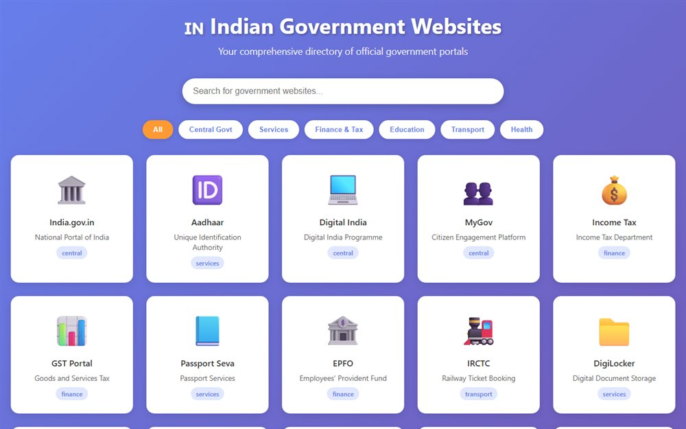

# Indian Government Websites

A hand-curated directory of official Indian government websites - ministries, departments and services in one list.

**[Open the live site](https://ajeet-iitk.github.io/IndianGovt/)**

## What it does

A plain, fast list of official Indian government portals. Useful when you need the actual ministry site and would rather not wade through search results full of look-alikes.

## Features

- Categorised list of official sites
- Static HTML - loads instantly and works offline once saved
- Adding an entry is one line of markup

## Run locally

Open `index.html`, or use the hosted copy:

<https://ajeet-iitk.github.io/IndianGovt/>

## Files

| File | Purpose |
| --- | --- |
| `index.html` | Landing page |
| `indian_gov_websites.html` | The directory |

---

Part of [my collection of small projects](https://github.com/Ajeet-iitk).
